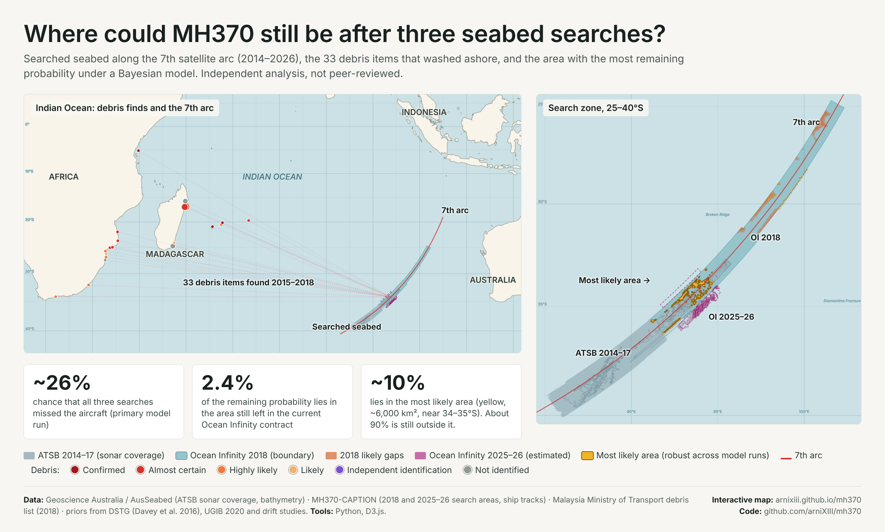

# MH370 residual-probability map — v1.0

**Version 1.0 · 20 November 2026 · Independent analysis, not peer-reviewed.**



An interactive map and a reproducible Bayesian calculation of where MH370 could still be along the 7th arc, given the seabed areas that have already been searched (ATSB 2014–17, Ocean Infinity 2018, Ocean Infinity 2025–26) and the debris found on African and Indian Ocean shores.

- **Map:** `index.html` (served via GitHub Pages)
- **Protocol** (questions, assumptions and decision rules fixed before the results): [docs/protocol.md](docs/protocol.md)
- **Results:** [docs/results.md](docs/results.md)
- **Data sources and licences:** [DATA_SOURCES.md](DATA_SOURCES.md)

## Headline results (primary run)

| Region | Area (km²) | Prior | Posterior |
|---|---:|---:|---:|
| R1 – OI remaining contract area (2025-26 zone not yet searched) | 8,006 | 0.6% | 2.4% |
| R2 – likely gaps inside the 2018 OI area | 13,436 | 1.6% | 6.2% |
| R3 – never searched, within 25 NM of the arc | 70,680 | 2.3% | 8.8% |
| R4 – never searched, 25–100 NM from the arc | 741,450 | 12.2% | 46.6% |
| R5 – searched cells (imperfect detection) | 244,801 | 83.3% | 36.0% |

- Probability that every completed search missed the aircraft (given the model): 26.1%.
- R1 holds 2.4%; the best unsearched area of equal size elsewhere holds 12.3%. Under this model, R1 is not the best next place to search.
- The result depends mostly on the end-of-flight assumption (glide vs. no glide) and the along-arc prior. Thirteen sensitivity runs are included and selectable on the map.
- Exploratory addendum: the highest-probability 10,000 km² holds 13.2% (7.6–28.8% across runs). Its most robust part is near 34.2°S 93.5°E, close to the UGIB 2020 estimate. See the addendum in the results.

Read [docs/results.md](docs/results.md) for the full answers, sensitivity table and limitations.

## Reproducing

Python 3.10+.

```bash
pip install -r requirements.txt
python scripts/01_fetch_caption.py   # downloads the CAPTION search-area files into data/caption/ (not redistributed here)
python scripts/02_arc.py             # fits the satellite position, builds the 7th arc
python scripts/03_atsb_coverage.py   # decodes ATSB sonar coverage
python scripts/04_inputs.py          # builds the 0.02° grid: slope, OI 2018 and 2025-26 coverage
python scripts/05_posterior.py       # priors, detection, posterior, all runs -> out/results.json
python scripts/06_build_map.py       # -> index.html
```

Running the steps reproduces `out/results.json` exactly. The three files in `data/derived/` were read from web map services and a published figure in a browser; how this was done is described in [scripts/acquire/README.md](scripts/acquire/README.md), with the console scripts used.

## Repository layout

```
index.html              built map (open directly or via GitHub Pages)
map/template.html       map source; 06_build_map.py fills in the data
scripts/                pipeline 01–06, common helpers, acquire/ (browser scripts)
data/derived/           ATSB coverage mask, slope classes, digitised DSTG prior
data/points.json        debris finds, drift-model predictions, ship positions
data/land_clip.json     coastline (Natural Earth, public domain)
docs/                   protocol and results
out/                    generated outputs
```

## Credits

- Search-area polygons and ship tracks: **CAPTION** (trise5631.github.io). These files have no stated licence, so they are downloaded by the script and not included here.
- ATSB sonar coverage and bathymetry: Geoscience Australia / AusSeabed, CC BY 4.0.
- Along-arc prior: digitised from Davey et al. (2016), *Bayesian Methods in the Search for MH370*, Fig. 10.3.
- Debris list: ATSB and Malaysian Safety Investigation Team reports.

Full list in [DATA_SOURCES.md](DATA_SOURCES.md).

## Limitations

This is a model, not a finding. Detection probabilities are assumptions, coverage was reconstructed from public maps (within about 8% of official figures), and Ocean Infinity's 2025–26 coverage is approximated from ship positions. Corrections are welcome as issues.

## Licence

Code: MIT (see [LICENSE](LICENSE)). Data keeps the licence of its source.
